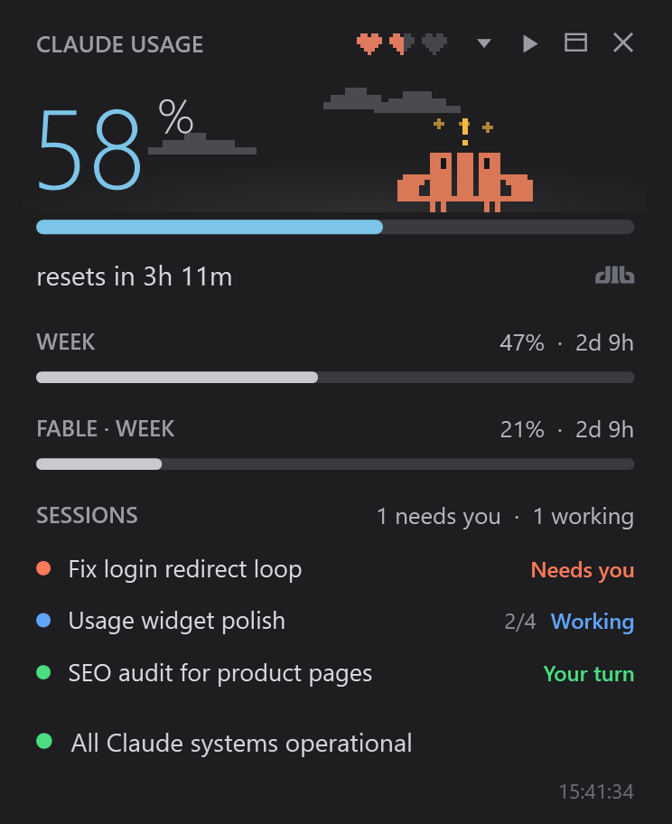
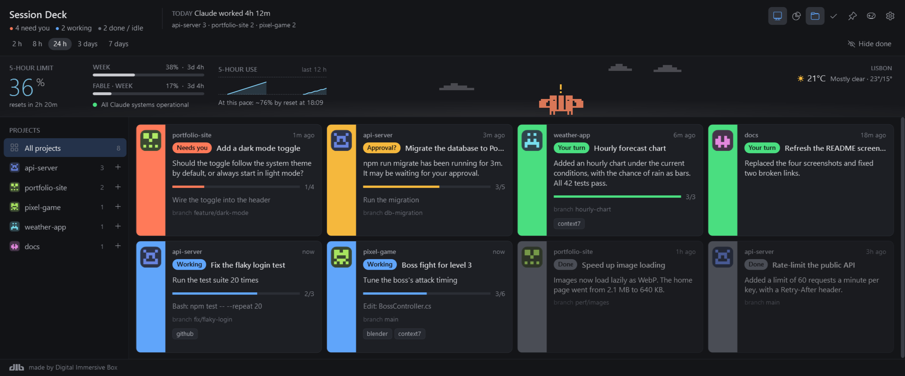
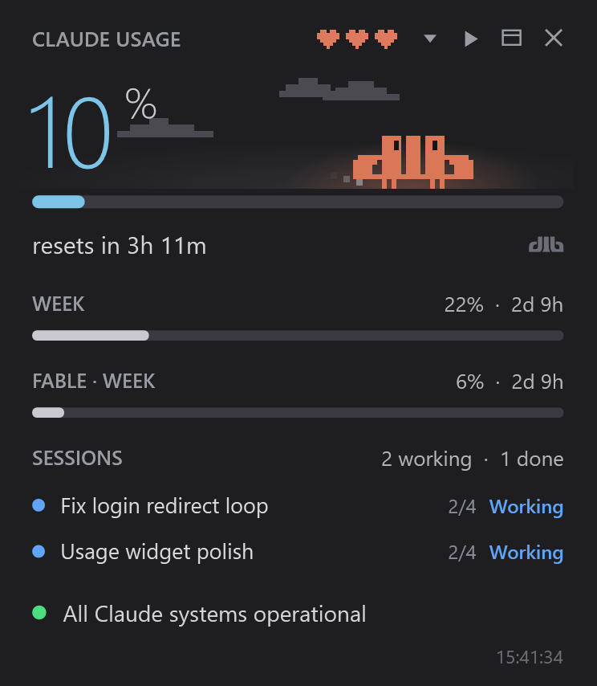
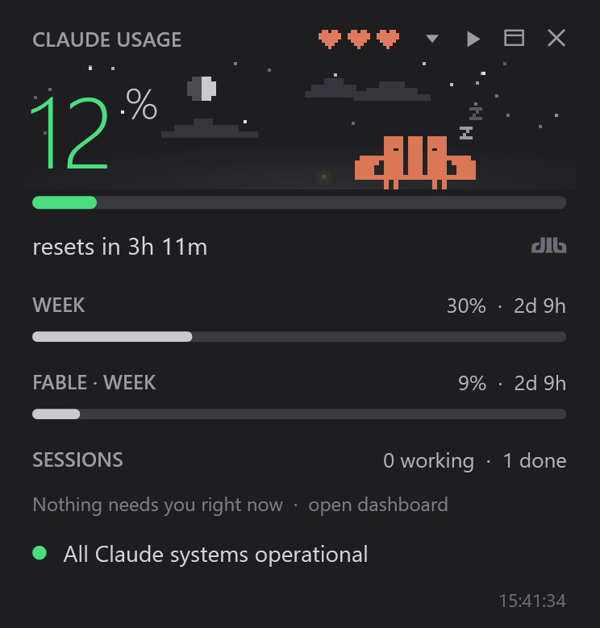
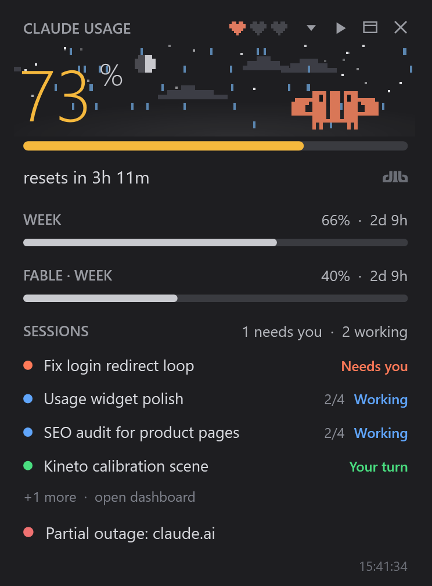
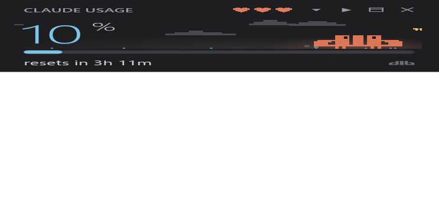
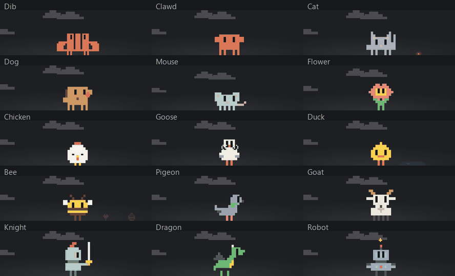
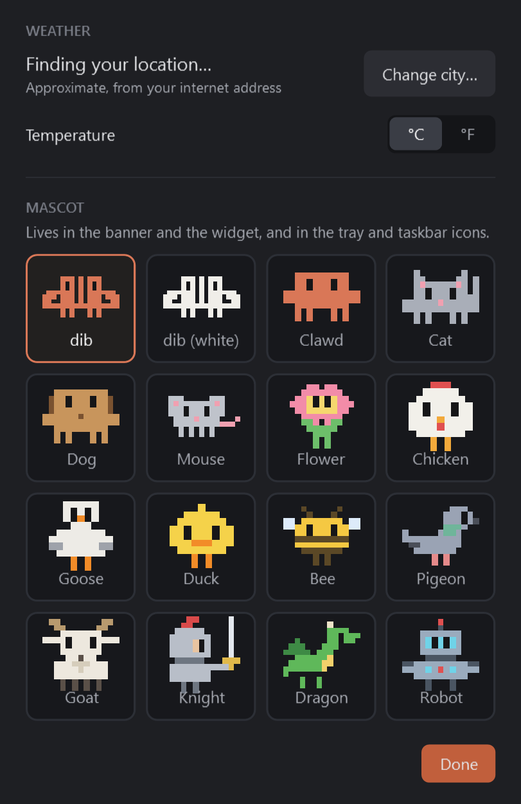
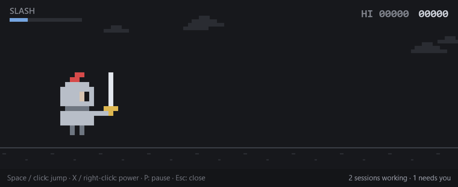

<p align="center">
  
</p>

<h1 align="center">Session Deck</h1>

<p align="center">
  A Windows tray app that keeps an eye on your <b>Claude Code</b> sessions and your <b>Claude plan usage</b>,<br>
  so you know which session needs you without flipping through windows.
</p>

<p align="center">
  <a href="https://github.com/DigitalImmersiveBox/SessionDeck/releases/latest"><b>⬇ Download for Windows</b></a>
  &nbsp;·&nbsp;
  <a href="#features">Features</a>
  &nbsp;·&nbsp;
  <a href="#build-from-source">Build from source</a>
</p>

---

## Features

### A dashboard of every session

<p align="center">
  
</p>

Session Deck reads the transcripts Claude Code writes on your PC and works out what each session is doing right now:

| Status | Meaning |
|---|---|
| 🟠 **Needs you** | Claude asked a question or is waiting for a permission |
| 🔵 **Working** | Claude is running, with its plan progress (`2/4`) |
| 🟢 **Your turn** | Claude finished and is waiting for your next message |
| ⚪ **Done** | Finished and already checked |

- Sessions are shown as cards, sorted so the ones that need you come first. Click a card to jump straight to that session in the Claude desktop app.
- Filter by project, by time range (2 h, 8 h, 24 h, 3 days, 7 days) or hide finished sessions.
- A **Today** strip shows how many sessions and turns you ran and how long Claude worked.
- A **Tokens** view charts token use per project or per session (donut, bars, treemap or timeline), with cache reads on or off.
- Windows notifications when a session needs you or finishes.

### A usage widget on your desktop

A small always-on-top widget shows your **5-hour limit**, your **weekly limits** (including per-model ones) and when each resets, the sessions that need you, and the Claude service status.

<p align="center">
  
  
  
</p>

The sky in the widget follows the real world: day and night, the local weather (from [Open-Meteo](https://open-meteo.com/)), and a storm when Claude has an outage. There is also a compact mode:

<p align="center">
  
</p>

### Pick a mascot

Sixteen pixel mascots live in the banner, the widget and the tray icon. Each one has its own little story and a signature move.

<p align="center">
  
</p>

<p align="center">
  
</p>

### A runner game while you wait

Play a one-button runner with your mascot while your sessions work: jump over bugs, merge conflicts and coffee spills. The game pauses and tells you as soon as a session needs you. There's a daily course too.

<p align="center">
  
</p>

## Install

1. Download **`SessionDeck-<version>-win-x64.zip`** from the [latest release](https://github.com/DigitalImmersiveBox/SessionDeck/releases/latest).
2. Unzip it anywhere (for example `%LocalAppData%\Programs\SessionDeck`) and run **`SessionDeck.exe`**.
3. Windows SmartScreen may warn you because the app isn't code-signed. Click **More info → Run anyway**.

The app lives in the system tray. Right-click the tray icon to open the dashboard, show or hide the widget, turn notifications on or off, pick a mascot, or turn on **Start with Windows**.

### Requirements

- Windows 10 or 11, 64-bit.
- [Claude Code](https://claude.com/claude-code) signed in on the same PC (the CLI or the Claude desktop app). Session Deck has no login of its own.

The release zip is self-contained, so you don't need to install .NET. The release also has a smaller `SessionDeck-<version>-win-x64-framework.zip` for people who already have the [.NET 10 Desktop Runtime](https://dotnet.microsoft.com/download/dotnet/10.0).

## Privacy

Session Deck runs only on your PC. It doesn't have a server and it doesn't collect anything.

- **Sessions:** it reads Claude Code's transcripts in `%UserProfile%\.claude\projects` and the Claude desktop app's session list. It never writes to them.
- **Usage:** it asks `api.anthropic.com` for your plan limits with Claude Code's own sign-in (the same call behind Claude Code's `/usage`). It never copies, refreshes or stores that token. When the sign-in expires, it asks the `claude` CLI to renew it or opens `claude auth login` for you.
- **Service status:** from `status.claude.com`.
- **Weather:** your approximate city comes from your internet address (via `ipapi.co`, falling back to `ipwho.is`) once a day, and the forecast comes from Open-Meteo. You can set a city by hand in Settings instead.
- **Settings** are saved in `%AppData%\SessionDeck`.

Session Deck is an independent tool. It isn't made or endorsed by Anthropic.

## Build from source

You need the [.NET 10 SDK](https://dotnet.microsoft.com/download/dotnet/10.0) on Windows.

```bash
git clone https://github.com/DigitalImmersiveBox/SessionDeck.git
cd SessionDeck
dotnet run --project src/SessionDeck
```

To build a single-file exe that doesn't need .NET installed:

```bash
dotnet publish src/SessionDeck -c Release -r win-x64 --self-contained true -p:PublishSingleFile=true -p:IncludeNativeLibrariesForSelfExtract=true -p:EnableCompressionInSingleFile=true -o release
```

### Project layout

| Folder | What's in it |
|---|---|
| `src/SessionDeck` | The app's startup (`App.xaml`), settings and demo data |
| `src/SessionDeck/Sessions` | Reading Claude Code's transcripts and session list, projects and token counts |
| `src/SessionDeck/Usage` | Plan usage, usage history and the Claude Code CLI sign-in helper |
| `src/SessionDeck/Weather` | Local weather from Open-Meteo |
| `src/SessionDeck/Windows` | The dashboard, usage widget, token view and dialogs |
| `src/SessionDeck/Controls` | Tray icon, menus and charts |
| `src/SessionDeck/Mascots` | The pixel mascots, their scenes and stories |
| `src/SessionDeck/Runner` | The runner game |
| `docs/images` | README screenshots |

### Command-line flags

| Flag | What it does |
|---|---|
| `--tray` | Start in the tray without opening the dashboard |
| `--demo` | Show made-up states in the usage widget |
| `--dashboard <file.png>` | Render the dashboard filled with made-up sessions to PNG, then exit (reads none of yours) |
| `--snapshot <dir>` | Render every widget demo state and the settings dialog to PNG, then exit |
| `--runner <dir> [--daily]` | Record the runner game playing itself, frame by frame, then exit |
| `--stories <dir>` / `--signatures <dir>` | Render each mascot's story or signature move, frame by frame, then exit |
| `--token-charts <dir>` | Render the token charts from your own logs to PNG, then exit |
| `--dump <file>` | Write one session scan as JSON, then exit (for troubleshooting) |
| `--mascot <name>` | Which mascot to draw for `--dashboard`, `--snapshot`, `--runner` and `--write-icon` |
| `--write-icon <file.ico>` | Regenerate the app icon from the mascot |

## License

[MIT](LICENSE) © Digital Immersive Box
